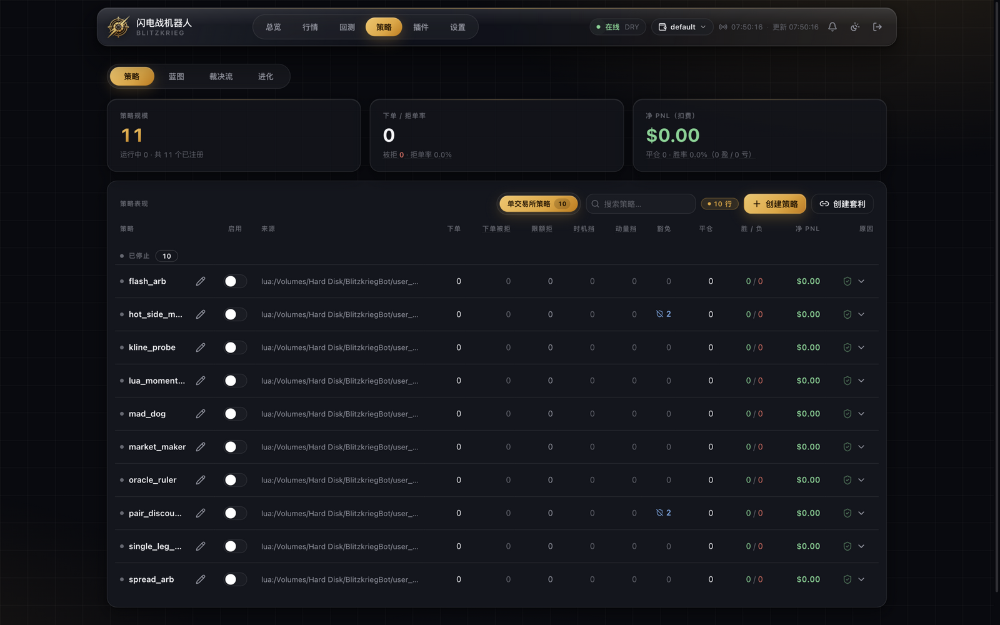

# BlitzkriegBot

<div align="center">


**盯着 Polymarket 15 分钟一局的 UP/DOWN 加密轮盘，按你的策略自动交易的自驱动机器人。**

dry 模拟出厂默认 · 内核零策略 · 一条命令起全套 · 100% Rust

[](https://github.com/ceer-quant/BlitzkriegBot/actions/workflows/ci.yml)
[](https://github.com/ceer-quant/BlitzkriegBot/actions/workflows/security.yml)
[](https://github.com/ceer-quant/BlitzkriegBot/actions/workflows/secret-scan.yml)
[](https://github.com/ceer-quant/BlitzkriegBot/actions/workflows/release.yml)
[](./LICENSE)
[](https://doc.rust-lang.org/edition-guide/)


*行情页：轮盘倒计时、UP/DOWN 盘口深度、OBI 失衡、战绩卡——浏览器打开即看，dry 模式零资金风险。*

**⚠️ 预测市场交易有真实资金风险。本项目默认 dry 模拟模式，仅供学习与研究，不构成投资建议。**

</div>

---

## 为什么是 BlitzkriegBot

市面上不缺「能下单的交易机器人」。缺的是把**下单之前的每一件事**做认真的那一个：

**1. 出厂即安全，不是默认即裸奔。**
dry 模拟是硬编码默认；`--readonly` 是结构性只读——进程从根上不构造下单通道，不是「不点那个按钮」；内核出厂 0 个启用策略，装了策略包也只是「已安装、已关闭」。碰到真钱的唯一路径是真人手动改 `DRY_RUN=false`，且整条 Live 链路在[功能证据分级](./docs/FEATURES.md)里被诚实标注为「未验证」。

**2. 可靠性是被机器证明的，不是被口头承诺的。**
账本与场地报数逐窗对账、无法归属的成交回报响亮告警、场地现金异动探测器、场地冻结自愈、双平台 CI + 30 余套零依赖端到端门禁 + CodeQL + 密钥扫描。这套机器每天在真实行情上跑（见[可靠性是如何被机器证明的](#可靠性是如何被机器证明的)）。

**3. 策略研究有闭环，还有一句实话。**
回放、回测、影子进化、近失样本、冻结语料 holdout——并且项目肯把否定结论写进 README：官方配对套利在 34 小时冻结语料上实测最优配置 PF 仅 0.659（胜率 85% 但逆向选择吃光价差），**因此被禁止进入实盘启用清单**。量过、不达标、不上——这是本项目的研究纪律。

**4. 内核市场无关，换市场 = 写一个插件。**
交易核心不含任何交易所 SDK；Polymarket / Kalshi / predict.fun / PolySimulator 都是同一契约（`core/market_api`）下的扩展 crate。内核不改一行。

## 60 秒上手（dry 模拟，零资金风险）

**路线 A：不装任何工具（推荐）**

到 [Releases](https://github.com/ceer-quant/BlitzkriegBot/releases) 下载对应平台（Linux x86_64 / macOS aarch64）的 `tar.gz`，解压后：

```bash
cd <解压目录>
bin/blitzkrieg run
```

浏览器打开 **<http://127.0.0.1:51888/panel>** ——完事。它在盯真实 Polymarket 轮盘、按真实盘口在本地模拟成交，你的钱包没有任何风险。

**路线 B：源码构建（开发者）**

```bash
git clone https://github.com/ceer-quant/BlitzkriegBot.git
cd BlitzkriegBot && cargo build --release --workspace --locked
bash scripts/install-blitzkrieg-shim.sh   # 可选：把 blitzkrieg 装进 PATH
blitzkrieg run
```

**接下来想让它动起来**：面板 → 策略页 → 打开某个策略的开关（按账户启用）——仅此一步，之后它自己发现轮盘、自己扫描、自己下单平仓。想让网页能下命令（启停/开关策略），把 `.env.example` 复制为 `.env` 并设置 `BLITZKRIEG_PANEL_USER` / `BLITZKRIEG_PANEL_PASSWORD`。

<details>
<summary><b>Windows 用户：用 WSL2 安装</b>（本机器人原生不支持 Windows，依赖 Unix 域套接字）</summary>

1. 管理员 PowerShell 执行 `wsl --install`，重启（老机器先确认 `wsl -l -v` 的 VERSION 是 2）。
2. Ubuntu 里装工具链：
   ```bash
   sudo apt update && sudo apt install -y build-essential pkg-config libssl-dev git curl
   curl --proto '=https' --tlsv1.2 -sSf https://sh.rustup.rs | sh -s -- -y
   source "$HOME/.cargo/env"
   ```
3. **代码必须放在 WSL 文件系统里**（`~` 下），不要放 `/mnt/c/...`（9P 跨盘 I/O 慢一个数量级）：
   ```bash
   git clone https://github.com/ceer-quant/BlitzkriegBot.git && cd BlitzkriegBot
   cargo build --release --workspace --locked && bash scripts/install-blitzkrieg-shim.sh && blitzkrieg run
   ```
4. Windows 浏览器直接打开 `http://127.0.0.1:51888/panel`（WSL2 localhost 自动转发，`wsl hostname -I` 的内部 IP 不用）。

三个 WSL 特有坑：**`wsl --shutdown` 或最后一个 WSL 进程退出约 8 秒后会杀掉机器人**（长跑保持 Ubuntu 窗口开着，或用 Windows 任务计划执行 `wsl -e bash -lc "cd ~/BlitzkriegBot && blitzkrieg run"`）；重启电脑后需手动 `blitzkrieg run`；数据在 `\\wsl$\Ubuntu\home\<用户名>\BlitzkriegBot\data\` 可从 Windows 直接备份。内存紧张可在 `%UserProfile%\.wslconfig` 写 `[wsl2]` + `memory=4GB`。

</details>

## 它给你什么

| 能力 | 一句话 |
| --- | --- |
| 自驱动引擎 | 发现轮盘 → 扫描 → 信号 → 下单 → 出场，一条流水线全自动 |
| 多市场插件 | Polymarket（0.4.1 起默认）+ Kalshi / predict.fun / PolySimulator；换市场 = 写一个扩展 crate |
| Web 面板 + TUI | 轮次/行情/挂单/持仓/账本实时刷新；`--tui` 有终端版；单二进制 `run`/`stop` 全生命周期托管 |
| 多账户 | 每账户独立账本、独立余额、独立绑定交易所；「账户 × 策略」复合键控制启用 |
| 策略系统 | 11 个官方 Lua 策略包（安装即关闭）+ cdylib C ABI v2 热加载（vtable 已冻结）+ 画布式蓝图编辑器 |
| 研究闭环 | 行情回放（三模式）、面板内回测、影子进化（apply/rollback）、近失样本 |
| 风控硬限制 | 持仓数/单笔名义额硬上限策略不可豁免；九项系统限额与退出纪律面板热编辑 |
| 跨平台对冲 | 两腿原子下单、保护阶梯、结算对齐、裸腿自动补单/强平 |
| 一键运维 | `run`/`stop`/`upgrade`/`backup`/`doctor`/`net-check`；自更新状态机；看门狗停机告警 |



*策略页：11 个官方 Lua 包按账户启停（截图为出厂状态——全部关闭），每行可展开调参、看拒单原因分布。*

## 可靠性是如何被机器证明的

这一节讲的是「凌晨三点它还在跑，你凭什么信」：

- **账本对账窗口**：场地报数与本地账本按证据窗口逐笔核对，对不上的差额（比如场地在内核不知情时动了钱）立刻变成 RiskAlert + 审计 JSONL + 面板横幅——同族异常只响一次，不刷屏。
- **幽灵成交探测器**：无法归属到任何订单的成交回报，落审计并响亮报警，绝不进静默内存队列。
- **场地冻结自愈**：良性拒单不喂熔断计数，自动冻结在场地恢复后自动解除；手动冻结永不被自愈覆盖。
- **结构化只读 + 凭据纪律**：`--readonly` 从进程构造层面消除下单通道；凭据只走环境变量，`secret-scan` 扫工作树与全历史。
- **门禁矩阵**：30 余套零 npm 依赖的端到端门禁（自起临时内核、真实驱动订单链/对账/崩溃恢复/生命周期），CI 双平台跑；发现回归先写失败用例再修。
- **取证文化**：运行日志升级轮转保留上一代、审计 JSONL 全链落盘、`doctor`/`net-check` 只读探针一条命令回答「是场地的问题、主机的问题还是我们的问题」。

> 证据分级（实盘验证 / 离线验证 / 仅测试覆盖 / 未验证）以 [`docs/FEATURES.md`](./docs/FEATURES.md) 为权威——包括「整条 Live 链路未验证」这句。

## 策略研究闭环

```
行情回放/回测 → 冻结语料 holdout（PF ≥ 1.5 且净利润 > 0，两个不重叠窗口）→ 影子进化优胜劣汰 → 面板按账户启用
```

- **11 个官方 Lua 策略包**：折价套利、单腿/双腿配对、跨所套利、动量族、做市、恐慌接盘等——全部安装、全部默认关闭，源码即文档（`user_layer/strategies_lua/`）。
- **写策略不需要碰 Rust**：一个带 `manifest.json` 的目录就是一个策略包，Lua 沙箱（16MiB 内存 / 1e6 指令预算）内运行，投毒包会被沙箱拦下并报告。
- **画布蓝图**：面板里拖拽编译成 Lua 包；手写包也能进蓝图编辑器（源码模式）。
- **进实盘启用清单的唯一门票**：冻结语料 holdout 达标——`pair_arb` 实测 PF 0.659，被这条规则挡在门外，规则因它而立。

## 安全默认与红线

- **dry 出厂默认**；唯一碰真钱的开关是 `DRY_RUN=false` / `--mode live`，且需真人明确授权——项目硬性规则。
- **`--readonly` 结构性只读**：压过一切 live 请求，连下单通道都不构造。
- **面板只听本机**（`127.0.0.1:51888`），跨站来源一律 403；凭据在任何地址上都是必需的。勿暴露公网。
- **密钥只走环境变量**：`.env` 被 git 忽略，绝不入库；安全问题走 [`SECURITY.md`](./SECURITY.md) 私下披露。

## FAQ

**Q：我要装 Node.js 吗？** 不用。生产是 100% Rust；Node 22 只跑开发门禁脚本（零 npm 依赖），只跑机器人用不到。

**Q：面板打不开？** 先 `blitzkrieg stop` 再 `blitzkrieg run`（端口被旧栈占着时新栈绑不上）；地址是 `http://127.0.0.1:51888/panel`。

**Q：策略装了为什么不动？** 三道门：包在 `user_layer/strategies_lua/`（安装）→ 面板策略页按账户打开开关（启用）→ 请求了策略但一个都没加载成功时内核拒绝启动（保护）。启动日志逐包打印装载与启用状态。

**Q：数据存哪里？** 仓库根 `data/` 下：成交/订单/持仓 JSONL、`accounts.toml`、策略启用集。`blitzkrieg backup` 一键备份（每日轻量 + 周日全量）。

**Q：怎么升级？** `blitzkrieg upgrade`（构建 → 停栈 → 换装 → 起栈 → 身份校验，全自动，上一代日志轮转保留）；或 `git pull && cargo build --release --workspace --locked`。正式版本以 [Releases](https://github.com/ceer-quant/BlitzkriegBot/releases) tag 为准（当前 **0.4.1**）。

**Q：能拿真钱跑吗？** 技术上存在 live 模式，但整条 Live 链路**未经验证**（见 [docs/FEATURES.md](./docs/FEATURES.md) 证据分级），且开启需真人明确授权。钱包里放你亏得起的钱，本项目不对任何损失负责。

**Q：支持 Windows 吗？** 原生不支持，唯一受支持用法是 WSL2（见上方折叠节）。

**Q：怎么彻底停掉？** `blitzkrieg stop`——面板与核心一起收，重复执行无害，只碰自己 socket 上的进程族。

## 文档导航

| 文档 | 内容 |
| --- | --- |
| [docs/FEATURES.md](./docs/FEATURES.md) | 功能清单与**证据分级**（哪个功能被什么验证过） |
| [docs/rust-core/ARCHITECTURE.md](./docs/rust-core/ARCHITECTURE.md) | Rust 分层架构与扩展体系 |
| [docs/rust-core/STRATEGY_GUIDE.md](./docs/rust-core/STRATEGY_GUIDE.md) | 编写与加载策略 |
| [docs/rust-core/EXTENSION_GUIDE.md](./docs/rust-core/EXTENSION_GUIDE.md) | 新增一个市场扩展 |
| [docs/rust-core/INTERFACES.md](./docs/rust-core/INTERFACES.md) | UDS JSON-RPC 2.0 契约 |
| [docs/rust-core/ABI_V2_DESIGN.md](./docs/rust-core/ABI_V2_DESIGN.md) | 策略 C ABI v2 设计 |
| [docs/VERSIONING.md](./docs/VERSIONING.md) | 版本单事实来源与发布流水线 |
| [scripts/README.md](./scripts/README.md) | 运维脚本手册（看门狗/备份/巡检） |
| [CONTRIBUTING.md](./CONTRIBUTING.md) | 贡献流程（架构红线与门禁是硬性的） |
| [.env.example](./.env.example) | 环境变量全家福（`BK_*` / `BLITZKRIEG_*` / `POLYMARKET_*`） |

<details>
<summary><b>给开发者：架构、目录、常用旗标与门禁</b></summary>

### 工作原理

```
┌──────────────────────────────┐        spawn + 生命周期托管
│  blitzkrieg 网关（Rust）      │ ───────────────────────────────┐
│  Vue 面板 · snapshot/命令 API │                                  │
│  127.0.0.1:51888             │ ◀── UDS（$TMPDIR/*.sock）        │
└──────────────────────────────┘     JSON-RPC 2.0，'\n' 分帧       │
                                            ▲                       ▼
┌───────────────────────────────────────────┴───────────────────────────┐
│                         blitzkrieg-core（Rust）                          │
│  engine/ome · order · position · risk · exit_policy · reconcile        │
│  strategy_engine（cdylib + Lua 热加载，内核 0 策略） · shadow/evolution │
│  hedge（跨平台两腿对冲） · kline · execution_policy                    │
│  market registry（core 市场无关，无任何交易所 SDK）                      │
└────────────────────────────────────────┬───────────────────────────────┘
                                 │ 依 feature 挂接
                    ┌────────────┴────────────┐
                    │ extensions/*            │  polymarket / kalshi / predict.fun / polysimulator
                    └─────────────────────────┘
```

- 面板 ↔ 核心：本机 Unix 域套接字 + 换行分帧 JSON-RPC 2.0；IPC 契约唯一来源是 Rust serde 结构体（[`docs/rust-core/INTERFACES.md`](./docs/rust-core/INTERFACES.md)）。
- 市场抽象契约：`core/market_api` 的 `DataFeed` / `MarketDiscovery` / `OrderExecutor` / `MarketPlugin` trait——换交易所 = 写一个扩展 crate，内核不改一行。

### 目录结构

```
core/blitzkrieg_core   交易核心（市场无关）      core/market_api        市场扩展契约
extensions/*           polymarket/kalshi/predictfun/polysimulator
user_layer/            strategy_api · lua_runtime · strategies_lua（官方 11 包）· configs
ui/                    ui_kit（Web 网关）· ui_kit_panel（TUI + 单二进制启动器）· webapp（Vue）
scripts/               门禁与运维脚本（零 npm 依赖）
docs/ · dev-docs/      公开文档 · 内部文档（不入库）
```

### 配置与旋钮

- 配置优先级：**命令行参数 > `BK_*` 环境变量 > `user_layer/configs/default.toml` > 代码默认值**；启动时每个非默认值打印 `key=value (source)`；未知键逐个告警，绝不静默忽略。
- 常用旗标：`--mode dry|live` · `--readonly` · `--engine --feed-ws` · `--assets BTC,ETH,SOL,XRP` · `--round-sec 900 --min-time-left 180` · `--max-positions 2 --max-order-notional 6` · `--seed-balance 1000` · `--socket <path>` · `--enable/disable-strategy` · `--replay`。全表见 `blitzkrieg --help` 与 [`docs/rust-core/ARCHITECTURE.md`](./docs/rust-core/ARCHITECTURE.md)。
- 服务器部署：`BLITZKRIEG_PANEL_ADDR=0.0.0.0:51888`（凭据必需；跨站一律 403）。

### 本地验收门禁（提交前必须全绿）

```bash
cargo build --release --workspace --locked && cargo test --workspace --locked
node scripts/cycle-check.mjs          # 订单链端到端：挂单 → 成交 → 持仓 → 重估
node scripts/core-parity.mjs          # 核心 dry/live 双核对拍
bash scripts/secret-scan.sh           # 零依赖密钥扫描
cd ui/webapp/webui && npm run check:all   # 面板前端检查
```

### 分支与版本

`main` 仅经 PR 合入（全绿检查）；版本唯一事实来源是根 `Cargo.toml` 的 `version`（当前 **0.4.1**），tag `v<version>` 由 Release 工作流构建双平台资产，同一 tag 永不覆盖。详见 [`docs/VERSIONING.md`](./docs/VERSIONING.md)。

### 策略进入条件（对任何未来策略）

**冻结语料 holdout：PF ≥ 1.5 且净利润 > 0，并在两个互不重叠的窗口上同时成立。** 这条规则来自 `pair_arb`：实测最优配置 PF 仅 0.659（胜率 85%，逆向选择吃掉全部价差），因此被禁止进入任何默认启用清单。没有 holdout 基线的策略不进入度量口径。

</details>

## 许可证

[MIT](./LICENSE) © 2026 BlitzkriegBot contributors (ceer-quant)。欢迎贡献：请先读 [`CONTRIBUTING.md`](./CONTRIBUTING.md)。

---

**再次提醒**：预测市场交易有真实资金风险。本项目按「现状」提供，仅供学习与研究——默认 dry 模拟，请勿在未经充分测试与明确授权的情况下接入真实资金。
