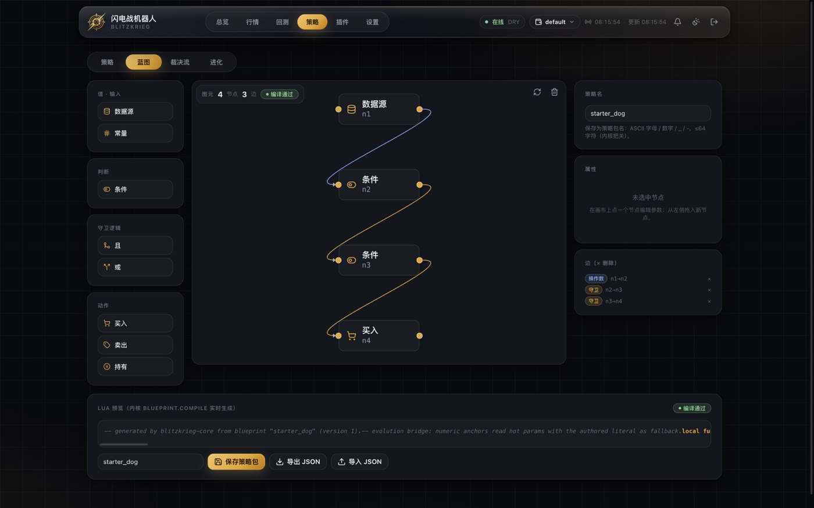
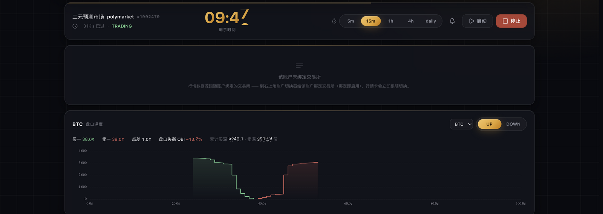

# BlitzkriegBot

<div align="center">


### 把交易想法，变成可运行的策略。

用可视化蓝图或 Lua 创建策略，在回测与模拟环境中验证，通过面板管理账户与风险。

**[开始模拟](#quickstart) · [创建第一条策略](#blueprint) · [查看验证范围](./docs/FEATURES.md)**



*从节点连线到 Lua 策略包，让交易逻辑看得见、改得动。*

</div>

默认 dry 模拟，策略安装后默认关闭。实盘涉及真实资金风险，需要充分验证与明确授权；本项目不构成投资建议。

## 从一个想法开始

**创建策略 → 回测评估 → 模拟运行 → 满足验证与授权条件后实盘**

| 你要做什么 | 在 BlitzkriegBot 中怎么做 |
| --- | --- |
| 把想法写成规则 | 在 Blueprint 连接数据源、条件与动作；需要更灵活的逻辑时编写 Lua。 |
| 检查策略是否值得继续 | 用支持的回放与回测入口评估历史表现，核对费用、回撤和成交假设。 |
| 观察它如何运行 | 在 dry 模式按账户启用，查看订单、持仓、账本与拒单原因。 |
| 决定是否进入实盘 | 对照功能证据与场地限制完成验证，再明确授权；模拟盈利不是实盘收益保证。 |

<a id="blueprint"></a>

## Blueprint：先搭出你的第一条策略

打开蓝图页，从节点面板选择输入、条件、守卫逻辑和动作，连接成一条规则：

```text
数据源 / 常量 → 条件比较 → 且 / 或组合 → 买入 / 卖出 / 持有
```

1. **搭逻辑**：拖入节点、连接端口，在属性面板调整参数。
2. **检查输出**：查看生成的 Lua 与编译结果；编译通过说明代码可加载，不代表策略有效。
3. **保存并试跑**：保存为策略包，在策略页选择账户，在 dry 模式启用并观察结果。

蓝图支持 JSON 导入与导出。手写 Lua 包也可以用源码模式打开，继续编辑。

## 一套策略包，逐步验证

策略包可在支持的回放、模拟与实盘入口复用，减少维护多套策略实现的负担。核心账务路径有 dry/live 对拍门禁，验证范围可在 [功能证据表](./docs/FEATURES.md) 查阅。

**复用代码，不等于复现市场。** 实盘仍受流动性、滑点、费用、网络延迟和场地规则影响；离线测试、dry 实况与部分真实下单验证分别说明不同范围，不能替代完整的实盘验收。

## Lua：从现有示例改起

不必先学习 Rust。一个带 `manifest.json` 的目录就是策略包，[官方 Lua 示例](./user_layer/strategies_lua/) 提供配对、动量、做市等逻辑，方便阅读和修改。

- **改策略**：编辑 Lua 与参数声明，由策略宿主加载。
- **管参数**：声明可调参数域后，通过面板调整；支持的参数可用于影子进化。
- **控执行**：内嵌沙箱限制内存与指令预算，帮助限制失控脚本的影响。

示例是研究起点，是否启用应由验证结果决定。

## Risk First：每次试跑都有边界

- **默认先模拟**：出厂使用 dry，策略安装不等于启用，按账户分别控制。
- **订单先过风控**：持仓数、单笔名义额等限制由内核执行，策略不能自行豁免。
- **异常可追踪**：无法归属的成交与现金异动进入告警和审计，便于核对账本。
- **可以只观察**：`--readonly` 不构造下单通道，用于只读检查。

## 从面板看到策略实际做了什么

Web 面板提供行情、订单、持仓、账本和策略管理；TUI 支持终端查看与操作。账户切换帮助你分别观察不同策略与场地的执行情况。

<details>
<summary>查看行情面板</summary>



*行情页展示倒计时与盘口深度。截图中的账户未绑定提示属于配置状态，使用前需完成账户与场地绑定。*

</details>

## 为策略研究提供可扩展的底座

交易核心与服务进程使用 Rust，策略宿主内嵌 Lua，Web 面板使用 Vue。运行预编译发行包无需另装 Node 或 Python；开发与构建依赖见下方文档。

项目提供 Polymarket、Kalshi、predict.fun 与 PolySimulator 连接器，各自的验证范围见 [功能证据表](./docs/FEATURES.md)。市场扩展与策略包通过独立契约接入，技术细节放在 [开发者文档](#developer-guide)。

[](https://github.com/ceer-quant/BlitzkriegBot/actions/workflows/ci.yml)
[](https://github.com/ceer-quant/BlitzkriegBot/actions/workflows/security.yml)
[](https://github.com/ceer-quant/BlitzkriegBot/releases)
[](./LICENSE)

<a id="quickstart"></a>

## 开始模拟

**路线 A：运行预编译发行包**

到 [Releases](https://github.com/ceer-quant/BlitzkriegBot/releases) 下载对应平台（Linux x86_64 / macOS aarch64）的 `tar.gz`，解压后：

```bash
cd <解压目录>
bin/blitzkrieg run
```

浏览器打开 **<http://127.0.0.1:51888/panel>**。先核对运行模式为 dry，再配置账户与策略；启用前不会自动运行策略。

**路线 B：源码构建（开发者）**

```bash
git clone https://github.com/ceer-quant/BlitzkriegBot.git
cd BlitzkriegBot && cargo build --release --workspace --locked
bash scripts/install-blitzkrieg-shim.sh   # 可选：把 blitzkrieg 装进 PATH
blitzkrieg run
```

**下一步**：首次配置时参考 `.env.example` 设置 `BLITZKRIEG_PANEL_USER` / `BLITZKRIEG_PANEL_PASSWORD`，让面板具备操作权限。然后创建或选择策略，确认账户绑定及 dry 模式，再按账户启用。

<details>
<summary><b>Windows 用户：用 WSL2 安装</b>（本平台原生不支持 Windows，依赖 Unix 域套接字）</summary>

1. 管理员 PowerShell 执行 `wsl --install`，重启（老机器先确认 `wsl -l -v` 的 VERSION 是 2）。
2. Ubuntu 里装工具链：
   ```bash
   sudo apt update && sudo apt install -y build-essential pkg-config libssl-dev git curl
   curl --proto '=https' --tlsv1.2 -sSf https://sh.rustup.rs | sh -s -- -y
   source "$HOME/.cargo/env"
   ```
3. **代码必须放在 WSL 文件系统里**（`~` 下），不要放 `/mnt/c/...`（9P 跨盘 I/O 慢一个数量级）：
   ```bash
   git clone https://github.com/ceer-quant/BlitzkriegBot.git && cd BlitzkriegBot
   cargo build --release --workspace --locked && bash scripts/install-blitzkrieg-shim.sh && blitzkrieg run
   ```
4. Windows 浏览器直接打开 `http://127.0.0.1:51888/panel`（WSL2 localhost 自动转发，`wsl hostname -I` 的内部 IP 不用）。

三个 WSL 特有坑：**`wsl --shutdown` 或最后一个 WSL 进程退出约 8 秒后会杀掉机器人**（长跑保持 Ubuntu 窗口开着，或用 Windows 任务计划执行 `wsl -e bash -lc "cd ~/BlitzkriegBot && blitzkrieg run"`）；重启电脑后需手动 `blitzkrieg run`；数据在 `\\wsl$\Ubuntu\home\<用户名>\BlitzkriegBot\data\` 可从 Windows 直接备份。内存紧张可在 `%UserProfile%\.wslconfig` 写 `[wsl2]` + `memory=4GB`。

</details>

## 安全默认与红线

- **dry 出厂默认**；唯一碰真钱的开关是 `DRY_RUN=false` / `--mode live`，且需真人明确授权——项目硬性规则。
- **`--readonly` 结构性只读**：压过一切 live 请求，连下单通道都不构造。
- **策略出厂全关**：内核 0 个启用策略；装包只是「已安装」，启用真值是「账户 × 策略」复合键。
- **密钥只走环境变量**：`.env` 被 git 忽略，绝不入库；安全问题走 [`SECURITY.md`](./SECURITY.md) 私下披露。
- **数据与你自己的判断归你**：本项目按「现状」提供，不构成投资建议，不对任何损失负责。

## FAQ

**Q：我要装 Node.js 吗？** 运行预编译发行包不需要。前端开发与构建需要 Node 和相应 npm 依赖；交易核心使用 Rust，Lua 运行时内嵌在策略宿主中。

**Q：面板打不开？** 先 `blitzkrieg stop` 再 `blitzkrieg run`（端口被旧栈占着时新栈绑不上）；地址是 `http://127.0.0.1:51888/panel`。

**Q：策略装了为什么不动？** 三道门：包在 `user_layer/strategies_lua/`（安装）→ 面板策略页按账户打开开关（启用）→ 请求了策略但一个都没加载成功时内核拒绝启动（保护）。启动日志逐包打印装载与启用状态。

**Q：数据存哪里？** 仓库根 `data/` 下：成交/订单/持仓 JSONL、`accounts.toml`、策略启用集。`blitzkrieg backup` 一键备份（每日轻量 + 周日全量）。

**Q：怎么升级？** `blitzkrieg upgrade`（构建 → 停栈 → 换装 → 起栈 → 身份校验，全自动，上一代日志轮转保留）；或 `git pull && cargo build --release --workspace --locked`。正式版本以 [Releases](https://github.com/ceer-quant/BlitzkriegBot/releases) tag 为准（当前 **0.4.1**）。

**Q：能拿真钱跑吗？** 平台实现了 live 模式，但开启需真人明确授权。已有文档记录部分场地下单/撤单验证，不能等同于全部场地、成交和结算链路完成端到端验收；详见 [docs/FEATURES.md](./docs/FEATURES.md)。钱包里放你亏得起的钱，本项目不对任何损失负责。

**Q：支持 Windows 吗？** 原生不支持，唯一受支持用法是 WSL2（见上方折叠节）。

**Q：怎么彻底停掉？** `blitzkrieg stop`——面板与核心一起收，重复执行无害，只碰自己 socket 上的进程族。

## 文档导航

| 文档 | 内容 |
| --- | --- |
| [docs/FEATURES.md](./docs/FEATURES.md) | 功能清单与**证据分级**（哪个功能被什么验证过） |
| [docs/rust-core/ARCHITECTURE.md](./docs/rust-core/ARCHITECTURE.md) | Rust 分层架构与扩展体系 |
| [docs/rust-core/STRATEGY_GUIDE.md](./docs/rust-core/STRATEGY_GUIDE.md) | 编写与加载策略 |
| [docs/rust-core/EXTENSION_GUIDE.md](./docs/rust-core/EXTENSION_GUIDE.md) | 新增一个市场扩展 |
| [docs/rust-core/INTERFACES.md](./docs/rust-core/INTERFACES.md) | UDS JSON-RPC 2.0 契约 |
| [docs/rust-core/ABI_V2_DESIGN.md](./docs/rust-core/ABI_V2_DESIGN.md) | 策略 C ABI v2 设计 |
| [docs/VERSIONING.md](./docs/VERSIONING.md) | 版本单事实来源与发布流水线 |
| [scripts/README.md](./scripts/README.md) | 运维脚本手册（看门狗/备份/巡检） |
| [CONTRIBUTING.md](./CONTRIBUTING.md) | 贡献流程（架构红线与门禁是硬性的） |
| [.env.example](./.env.example) | 环境变量全家福（`BK_*` / `BLITZKRIEG_*` / `POLYMARKET_*`） |

<a id="developer-guide"></a>

<details>
<summary><b>给开发者：架构、目录、常用旗标与门禁</b></summary>

### 工作原理

```
┌──────────────────────────────┐        spawn + 生命周期托管
│  blitzkrieg 网关（Rust）      │ ───────────────────────────────┐
│  Vue 面板 · snapshot/命令 API │                                  │
│  127.0.0.1:51888             │ ◀── UDS（$TMPDIR/*.sock）        │
└──────────────────────────────┘     JSON-RPC 2.0，'\n' 分帧       │
                                            ▲                       ▼
┌───────────────────────────────────────────┴───────────────────────────┐
│                         blitzkrieg-core（Rust）                          │
│  engine/ome · order · position · risk · exit_policy · reconcile        │
│  strategy_engine（cdylib + Lua 热加载，内核 0 策略） · shadow/evolution │
│  hedge（跨平台两腿对冲） · kline · execution_policy                    │
│  market registry（core 市场无关，无任何交易所 SDK）                      │
└────────────────────────────────────────┬───────────────────────────────┘
                                 │ 依 feature 挂接
                    ┌────────────┴────────────┐
                    │ extensions/*            │  polymarket / kalshi / predict.fun / polysimulator
                    └─────────────────────────┘
```

- 面板 ↔ 核心：本机 Unix 域套接字 + 换行分帧 JSON-RPC 2.0；IPC 契约唯一来源是 Rust serde 结构体（[`docs/rust-core/INTERFACES.md`](./docs/rust-core/INTERFACES.md)）。
- 市场抽象契约：`core/market_api` 的 `DataFeed` / `MarketDiscovery` / `OrderExecutor` / `MarketPlugin` trait——换交易所 = 写一个扩展 crate，内核不改一行。

### 目录结构

```
core/blitzkrieg_core   交易核心（市场无关）      core/market_api        市场扩展契约
extensions/*           polymarket/kalshi/predictfun/polysimulator
user_layer/            strategy_api · lua_runtime · strategies_lua（官方 11 包）· configs
ui/                    ui_kit（Web 网关）· ui_kit_panel（TUI + 单二进制启动器）· webapp（Vue）
scripts/               门禁与运维脚本（零 npm 依赖）
docs/ · dev-docs/      公开文档 · 内部文档（不入库）
```

### 配置与旋钮

- 配置优先级：**命令行参数 > `BK_*` 环境变量 > `user_layer/configs/default.toml` > 代码默认值**；启动时每个非默认值打印 `key=value (source)`；未知键逐个告警，绝不静默忽略。
- 常用旗标：`--mode dry|live` · `--readonly` · `--engine --feed-ws` · `--assets BTC,ETH,SOL,XRP` · `--round-sec 900 --min-time-left 180` · `--max-positions 2 --max-order-notional 6` · `--seed-balance 1000` · `--socket <path>` · `--enable/disable-strategy` · `--replay`。全表见 `blitzkrieg --help` 与 [`docs/rust-core/ARCHITECTURE.md`](./docs/rust-core/ARCHITECTURE.md)。
- 服务器部署：`BLITZKRIEG_PANEL_ADDR=0.0.0.0:51888`（凭据必需；跨站一律 403）。

### 本地验收门禁（提交前必须全绿）

```bash
cargo build --release --workspace --locked && cargo test --workspace --locked --features blitzkrieg-core/test-support
node scripts/cycle-check.mjs          # 订单链端到端：挂单 → 成交 → 持仓 → 重估
node scripts/core-parity.mjs          # 核心 dry/live 双核对拍
bash scripts/secret-scan.sh           # 零依赖密钥扫描
cd ui/webapp/webui && npm run check:all   # 面板前端检查
```

（`--features blitzkrieg-core/test-support`：集成测试要驱动内核的测试钝
mutator，#825 起该 feature 不再在 default 里——release 构建照旧走 default 面。）

### 分支与版本

`main` 仅经 PR 合入（全绿检查）；版本唯一事实来源是根 `Cargo.toml` 的 `version`（当前 **0.4.1**），tag `v<version>` 由 Release 工作流构建双平台资产，同一 tag 永不覆盖。详见 [`docs/VERSIONING.md`](./docs/VERSIONING.md)。

</details>

## 许可证

[MIT](./LICENSE) © 2026 BlitzkriegBot contributors (ceer-quant)。欢迎贡献：请先读 [`CONTRIBUTING.md`](./CONTRIBUTING.md)。

---

**再次提醒**：预测市场交易有真实资金风险。本项目按「现状」提供，仅供学习与研究——默认 dry 模拟，请勿在未经充分测试与明确授权的情况下接入真实资金。
