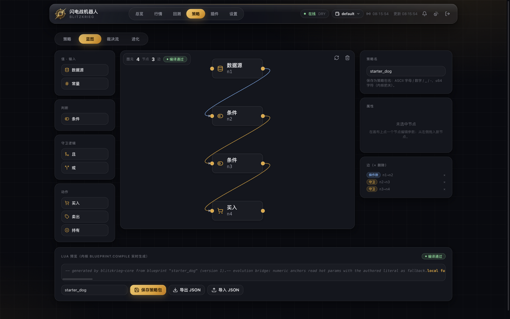
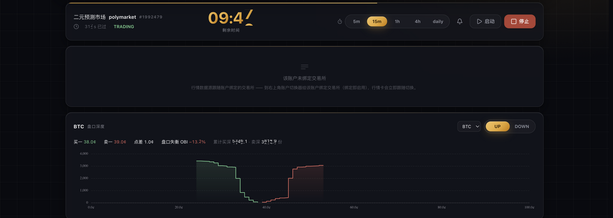
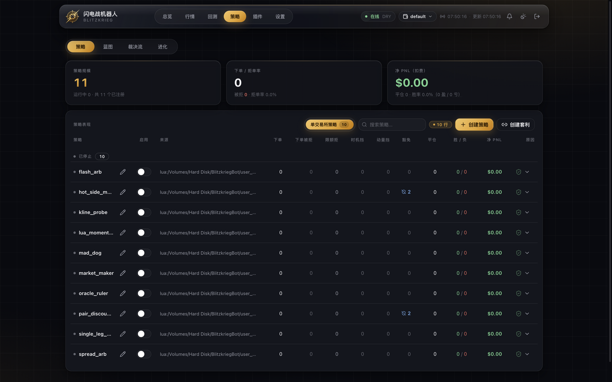

<section class="bb-hero">
  

    
TradingOS for independent traders

    <h1 class="bb-hero-title">BlitzkriegBot</h1>
    
独立交易者的 TradingOS

    
Build Once, Trade Everywhere.

    
不是又一个量化框架。Market-Agnostic Core、Risk-First Engine 与 Order Flow Engine 拼在一起，让个人交易者拥有机构级的交易基础设施。

    

      <a class="bb-btn bb-btn-brand" href="./getting-started">立即开始</a>
      <a class="bb-btn" href="#architecture">查看架构</a>
      <a class="bb-btn" href="https://github.com/ceer-quant/BlitzkriegBot" target="_blank" rel="noreferrer">GitHub</a>
    

  

  

    <figure class="bb-shot">
      
      <figcaption>真实运行画面 · Blueprint 面板</figcaption>
    </figure>
  

</section>

<section class="bb-sec bb-brands">
  
The stack

  <h2 class="bb-h2">三件法宝</h2>
  

    <article class="bb-card bb-brand-card">
      
      <h3 class="bb-brand-name">Song</h3>
      
超强性能 · 订单管理

      
Rust 原生，没有 GC、没有虚拟机。参数热路径用 ArcSwap 锁自由读，结构变更只发生在装配时；挂单、改价、撤单、成交与记账走同一条同步路径。

    </article>
    <article class="bb-card bb-brand-card">
      
      <h3 class="bb-brand-name">Stone</h3>
      
与实盘完全一致 · 回测

      
回测跑的就是实盘那个内核：同一份策略包、同一套撮合与费用、同一本账，只把交易所换成历史盘口重放。回测与实盘，不会各说各话。

    </article>
    <article class="bb-card bb-brand-card">
      
      <h3 class="bb-brand-name">PonyYiDan</h3>
      
现代好看 · 开箱易用

      
Vue 3 + TypeScript 的 WebUI：玻璃质感、亮暗双主题，鼠标键盘都顺手；服务器上没有图形界面时，纯 Rust 的 TUI 读同一份内核快照。

    </article>
  

  
三个名字，一条内核 —— 不是三套系统拼起来的外壳。

</section>

<section class="bb-sec">
  
Why different

  <h2 class="bb-h2">为什么 BlitzkriegBot 不一样？</h2>
  

    <article class="bb-card">
      <h3>Market-Agnostic Core</h3>
      
核心完全不知道市场。

      <ul class="bb-list">
        <li>已接入 Polymarket</li>
        <li>已接入 Kalshi</li>
        <li>已接入 PredictFun</li>
        <li>已接入 PolySimulator（仿真）</li>
        <li>Roadmap Crypto Spot / Futures / Options / Stocks</li>
      </ul>
      
市场在变，交易内核不变。新市场 = 新插件。

    </article>
    <article class="bb-card">
      <h3>Risk First</h3>
      
策略不能绕过风控。

      <ul class="bb-list">
        <li>每日亏损熔断（Loss Breaker）</li>
        <li>Readonly / Dry Run 三态</li>
        <li>持仓上限与组合级闸门</li>
        <li>单账户冻结与全局 kill</li>
      </ul>
      
先活下来，再赚钱。

    </article>
    <article class="bb-card">
      <h3>Order Flow Native</h3>
      
盯着盘口做交易，不是盯着 K 线。

      <ul class="bb-list">
        <li>挂单 / 撤单 / 改价全链路</li>
        <li>盘口深度与队列位置</li>
        <li>成交流与成交概率</li>
        <li>风控拒绝也能看见原因</li>
      </ul>
      
Alpha 来自执行质量。

    </article>
  

</section>

<section class="bb-sec" id="architecture">
  
Architecture

  <h2 class="bb-h2">TradingOS Architecture</h2>
  

    
<strong>Strategy Layer</strong>Blueprint / Lua

    
↓

    
<strong>Risk Engine</strong>风控闸门 · 先于下单

    
↓

    
<strong>Core Engine</strong>Rust · 订单与账本唯一真相

    
↓

    
<strong>Market API</strong>统一市场接口

    
↓

    

      Polymarket
      Kalshi
      PredictFun
      PolySimulator
      Crypto
      Futures
      Stocks
    

  

  
核心交易引擎永远不依赖具体市场。新市场 = 新插件。

</section>

<section class="bb-sec" id="lifecycle">
  
Lifecycle

  <h2 class="bb-h2">从一个想法到实盘</h2>
  

    Idea
    →
    Blueprint
    →
    Backtest
    →
    Simulation
    →
    Risk Validation
    →
    Live
  

  
同一套策略包贯穿全流程 —— 不是回测一套代码、实盘另一套代码。

</section>

<section class="bb-sec">
  
Order flow

  <h2 class="bb-h2">Order Flow Native</h2>
  
闪电战不是 K 线交易系统，而是订单流交易系统。策略关心的是盘口、深度、队列、流动性与成交概率，而不是指标预测。

  

    <article class="bb-card">
      <h3>看得见的执行</h3>
      <ul class="bb-list">
        <li>每一笔挂单都有价格、数量与档位</li>
        <li>撤单与改价不再黑箱</li>
        <li>maker / taker 分开记账</li>
      </ul>
    </article>
    <article class="bb-card">
      <h3>看得见的拒绝</h3>
      <ul class="bb-list">
        <li>被风控拦下的单带着原因与时间</li>
        <li>账户冻结、场地拒单、配置态统一进同一个闸门</li>
        <li>面板与实盘读同一份账本</li>
      </ul>
    </article>
  

</section>

<section class="bb-sec">
  
Real screenshots

  <h2 class="bb-h2">真实运行画面</h2>
  

    <figure class="bb-shot">
      
      <figcaption>控制面板 · Blueprint</figcaption>
    </figure>
    <figure class="bb-shot">
      
      <figcaption>事件市场 · BTC UP/DOWN</figcaption>
    </figure>
    <figure class="bb-shot">
      
      <figcaption>策略管理 · Lua</figcaption>
    </figure>
  

  
全部为实际运行截图，不是渲染图。

</section>

<section class="bb-sec">
  
Numbers

  <h2 class="bb-h2">Built Fast. Built Real.</h2>
  

    <RepoStat kind="changes" label="Commits" />
    <RepoStat kind="pullRequests" label="Pull Requests" />
    
<b data-count="100" data-suffix="%">100%</b>Rust Core

    
<b data-count="4">4</b>已接入市场

  

  
Commits 与 Pull Requests 是上一稳定版到最新 Release 的数量，和顶栏公告同一份数据。读不到发布记录时这两格不显示。Dry → Simulation → Live，同一条链路。

</section>

<section class="bb-sec" id="roadmap">
  
Roadmap

  <h2 class="bb-h2">走到哪了</h2>
  

    <article class="bb-card">
      <h3>已交付</h3>
      <ul class="bb-list check">
        <li>Core Engine</li>
        <li>Risk Engine</li>
        <li>Blueprint</li>
        <li>Polymarket / Kalshi / PredictFun 接入</li>
        <li>PolySimulator（dry 与回测）</li>
        <li>WebUI + TUI</li>
      </ul>
    </article>
    <article class="bb-card">
      <h3>下一步</h3>
      <ul class="bb-list todo">
        <li>Binance Spot</li>
        <li>Futures</li>
        <li>Stocks</li>
        <li>Market Making Engine</li>
        <li>Alpha Marketplace</li>
      </ul>
    </article>
  

</section>

<section class="bb-sec">
  
For developers

  <h2 class="bb-h2">For Developers</h2>
  <pre class="bb-code"><code>cargo build --release
(cd ui/webapp/webui && npm ci && npm run build)
blitzkrieg run</code></pre>
  

    BlueprintLuaMarket APIPlugin SystemWebUITUI
  

  
Everything Extensible.

</section>

<section class="bb-sec bb-mission">
  
Mission

  <h2 class="bb-h2">为什么叫 BlitzkriegBot？</h2>
  
因为我们信奉效率与可靠。闪电战讲的是决策快、执行快，并且在压力下不掉链子 —— 这套标准，我们原样搬进了交易系统。

  
今天，机构拥有做市系统、风控系统、仿真系统，而个人交易者手里通常只有指标和 K 线。

  
BlitzkriegBot 想改变这件事：用 Rust 写一套订单簿级的高性能交易框架，让个人交易者拿到与机构同一档的执行质量。

  
我们的目标不是制造更多交易机器人，而是为独立交易者提供属于自己的 TradingOS。

</section>
